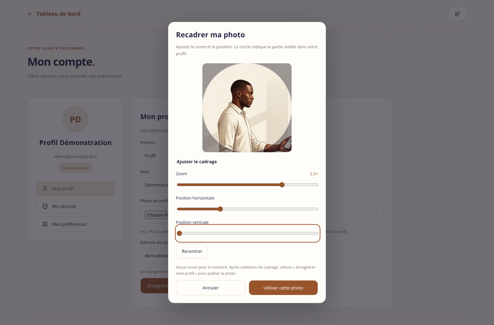
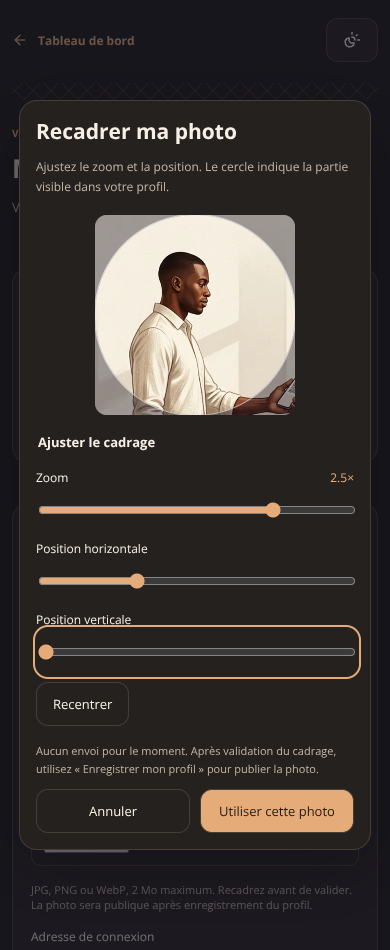

# Mon compte — recadrage de la photo

## Réalisé
- Choix d’une image JPG, PNG ou WebP de 2 Mo maximum, puis ouverture d’un dialogue local de recadrage.
- Zoom de 1× à 3×, position horizontale et verticale, bouton Recentrer. Les contrôles fonctionnent au clavier et au tactile.
- Aperçu carré avec masque circulaire représentant l’affichage dans le médaillon du profil.
- Validation du cadrage : réencodage de l’image en 512 × 512, WebP qualité 92 (PNG si le navigateur ne sait pas encoder WebP). Les octets, le nom et les métadonnées du fichier source ne sont pas recopiés dans le fichier exporté.
- Aucun envoi au choix de fichier ni à la validation du cadrage. Seul « Enregistrer mon profil » appelle l’upload existant et la RPC profil.
- Possibilité d’annuler le changement de photo avant l’enregistrement. Annuler un second recadrage conserve le premier brouillon. Le fichier d’origine reste intact.
- Erreurs de format, taille, décodage, dimensions et export traitées. Limite de 20 mégapixels pour le recadrage. Pas d’envoi de SVG ou d’un format arbitraire via cette interface.
- Boutons bloqués pendant l’export, garde contre les doubles validations, aucune confirmation après démontage. URLs temporaires révoquées, Échap et retour du focus au contrôle d’origine.
- Responsive et thèmes clair/sombre conservés. Aucun changement des permissions ni du stockage serveur dans ce lot.

## Activation
Le recadrage fonctionne localement sans migration supplémentaire. **La publication du profil/photo dépend toujours du bucket et de la RPC du lot Administration initial.** Ce lot n’applique aucune migration et ne certifie pas leur état en production.

Les photos restent publiques après publication, conformément au mécanisme existant de ce lot, avec mention dans le formulaire. Le recadrage ne modifie ni le consentement à publier, ni les droits d’accès.

## Captures du code (démonstration)
Le portrait utilisé pour vérifier l’éditeur est extrait de l’illustration Pointages déjà validée. Il ne représente pas un administrateur réel ; les requêtes d’enregistrement ont été simulées.

## Vérifications
- **784 tests / 80 fichiers réussis**, build réussi, gate ESLint sans erreur (warning préexistant EnterpriseSelectorModal).
- 7 nouveaux tests : géométrie portrait/paysage, limites, formats/taille, correspondance dessin/export, WebP et repli PNG, échec d’export, chargement, double validation, nettoyage et démontage.
- Chromium : 8 configurations clair/sombre × 320/390/768/1440 px. Zoom et déplacement, image résultante 512 × 512, absence d’envoi avant sauvegarde, annulation du second recadrage, Échap et focus, puis un seul upload et une seule sauvegarde simulés. Aucun débordement horizontal dans le dialogue, aucune erreur JavaScript.
- Aucun profil réel modifié, aucun mot de passe changé, aucune migration appliquée. Le programme Administration complet reste en cours.
