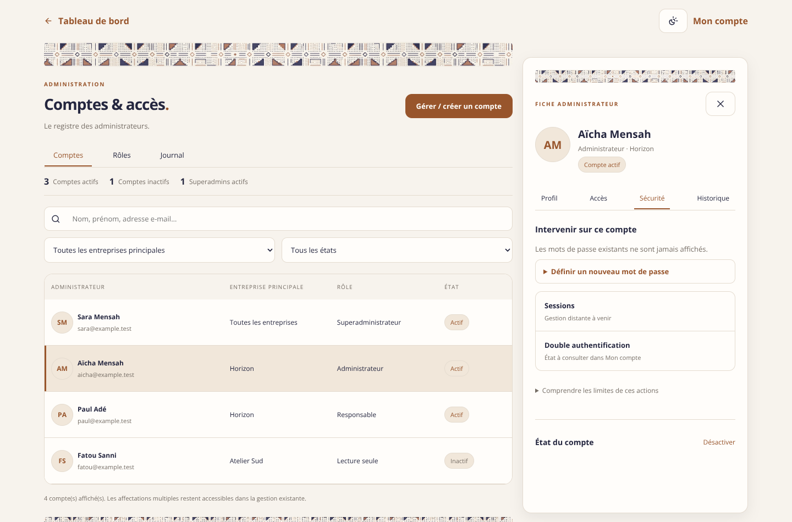
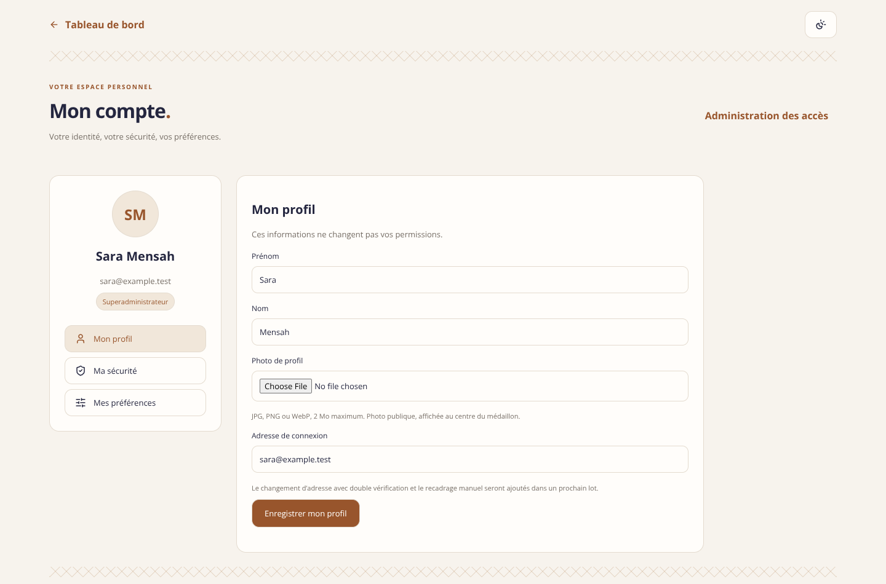
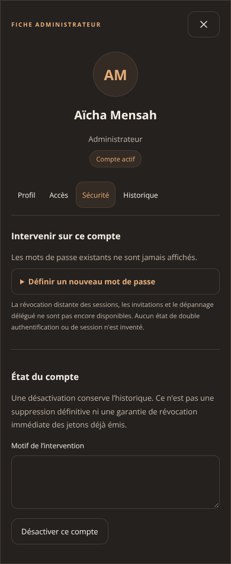
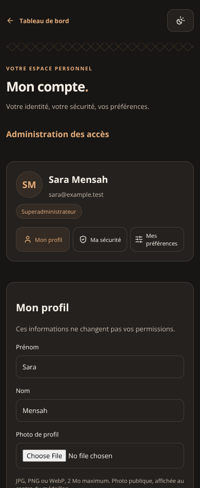

# Aperçu du redesign — directement sur GitHub

Ces captures proviennent du **code de la PR #123**, avec des **données fictives**. Ce ne sont ni les images générées de proposition ni des comptes réels. Les champs non visibles sur mobile sont accessibles en faisant défiler la page.

## Administration des accès — ordinateur

## Mon compte — ordinateur

## Mobile, thème sombre

## Prévisualisation interactive

Le robot de déploiement publie aussi une [prévisualisation de cette branche](https://en-check-git-arena-5a6988c0-en-check-butas-projects.vercel.app). Elle nécessite les autorisations de déploiement et une connexion En-Check ; le simple accès au dépôt ne connecte pas automatiquement au compte administrateur.

**Attention : une prévisualisation peut partager le backend du site. Ne pas tester une opération sensible sur un compte réel.** Les captures ci-dessus permettent de consulter le résultat sans connexion et sans intervention sur les données.

## Périmètre et activation

- [Lot 1 : interfaces, profil et état des comptes](ADMIN-COMPTES-LOT-1.md).
- [Suite : changement de mot de passe dans la fiche](ADMIN-COMPTES-MOT-DE-PASSE.md).
- Les migrations SQL sont versionnées mais **non appliquées au serveur**. Les fonctions restantes ne sont pas présentées comme terminées.

## Nouveau : recadrage de la photo personnelle

[Voir les captures et le fonctionnement du recadrage](ADMIN-PHOTO-RECADRAGE.md).
